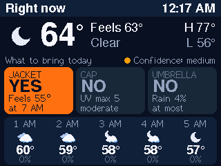

# Telegram bot with a desk weather display

A personal Telegram bot for AI chat, news, stocks and weather. It also drives a small
ESP32-S3 screen that shows the morning and afternoon weather brief, and there's a
3D-printable case for that screen.

## What's in here

| Path | What it is |
|---|---|
| `bot.py` | The bot. Start it with `py bot.py`. |
| `weather.py` | Forecasts from NWS and the ECMWF, GFS, ICON and GEM models (via Open-Meteo), blended into one. Every hour the earlier forecasts are checked against a weather station, so each source's weight follows its real accuracy. |
| `news.py`, `stocks.py` | NYT headlines and stock prices for the hourly posts |
| `memory.py` | Chat history and saved facts, kept in `memory_data/` |
| `display.py` | Sends the weather brief and the top headlines to the display every 2 minutes |
| `list_models.py` | Lists the Groq models your key can use |
| [`esp32-display/`](esp32-display) | The display's firmware: XIAO ESP32-S3 + 2" ST7789 screen, built with PlatformIO |
| [`esp32-display/case/`](esp32-display/case) | The case and desk dock: parametric model, STL files, build guide, 3D viewer |
| [`weather_experiment/`](weather_experiment) | A standalone script that ranks the 5 weather sources against a real station |

## Run the bot

1. Install the packages: `py -m pip install -r requirements.txt`
2. Copy `config.example.py` to `config.py` and fill in your keys.
3. Set your location (`HOME` in `weather.py`) and your stocks (`WATCHLIST` in `stocks.py`).
4. Start it: `py bot.py`, then send it `/help` in Telegram.

## Commands

- `/weather city`: weather and forecast (no city = `HOME`)
- `/wake 7:30`: your wake-up time, when the morning weather update comes
- `/subscribe`, `/unsubscribe`: hourly NYT headlines and stocks, plus weather updates
  when you wake up and at 1 PM
- `/news`: headlines and stocks right now
- `/stocks`: prices and NYT stories for your watchlist
- `/search question`: search the web for a live answer
- `/remember fact`, `/forget number`, `/memory`: facts the bot always knows
- `/reset`: start a new conversation (saved facts are kept)

Any other message is answered by the AI (Groq).

## Kept off GitHub

These stay on your computer only (see `.gitignore`):
- `config.py` and `.env`: your keys
- `memory_data/`: chat history and saved facts
- `state.json` and `weather_accuracy.json`: the bot's schedule and learned weather accuracy
