# Weather display case: build guide

A pocket-size case for the weather display, **62.4 × 41.9 × 14.4 mm**, with:
- 2 buttons on top
- a magnetic charging connector on the bottom
- USB-C on the right end for programming
- an optional desk dock that charges it and holds it tilted back 15°

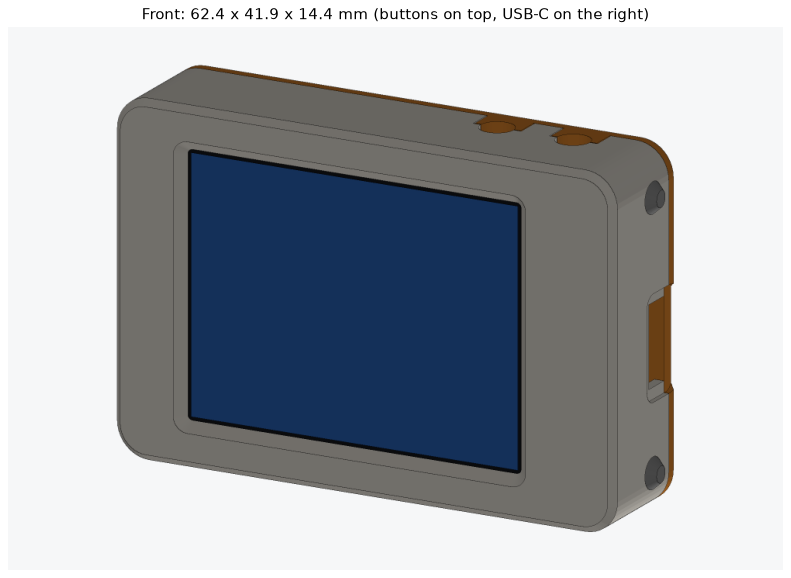
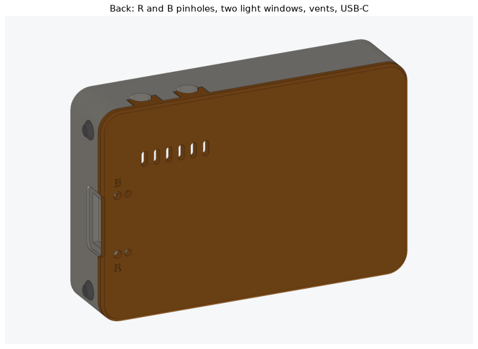

To turn the model around in 3D, open `viewer/weather_case_viewer.html` from your copy of
the project in a browser. You can explode it, cut through it and hide parts. It needs
an internet connection to load three.js.

## How it goes together

The display board (58 × 37.5 mm) nearly fills the case. Anything built onto the
inside walls behind it would stop it from going in, so the parts are split this way:

- **Shell** (front + walls): the display drops in face-down. The glass sits in a
  shallow pocket that lines the screen up with the window. The two buttons are
  **the switches' own stems**, poking out through round holes in the top wall. You
  press the switch itself, so nothing printed has to bend.
- **Back cover:** carries everything else. That's the XIAO, the battery, both switches
  and the magnetic connector. It closes onto the shell like a book, its tabs press
  the display into place, and 3 small screws in the ends hold it shut. Two small keys
  on it slide into slots in the top wall and finish the back halves of the button holes.

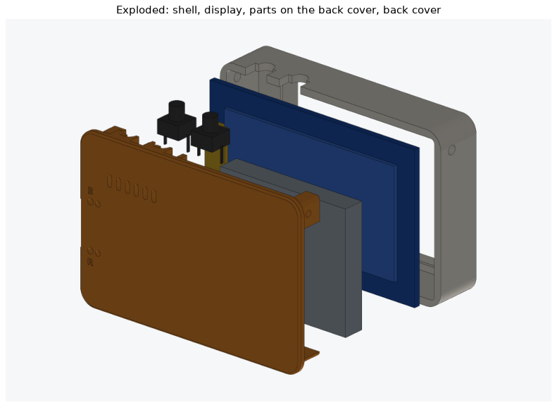
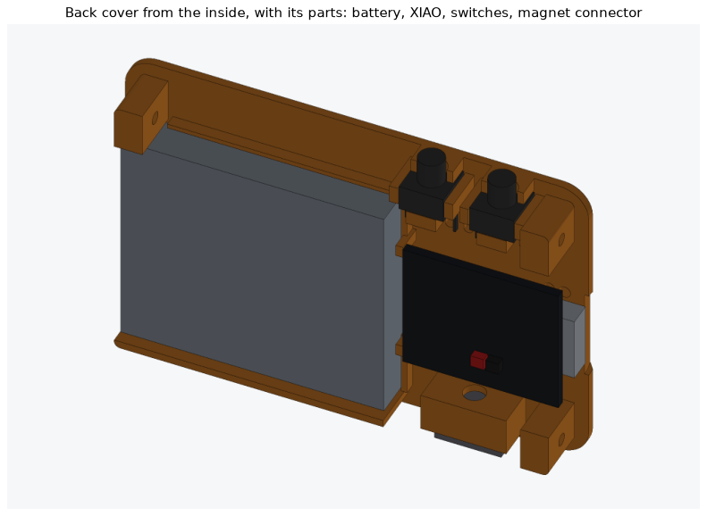

The parts stack front to back like this:

| Layer | From the front (mm) |
|---|---|
| Front plate (1.2 mm in front of the glass) | 0 – 1.2 |
| Display glass | 1.2 – 3.2 |
| Display board | 3.4 – 5.0 |
| Battery (left) / XIAO, parts side toward the back (right) | 6.9 – 12.4 / 8.4 – 12.8 |
| Back cover | 12.8 – 14.4 |

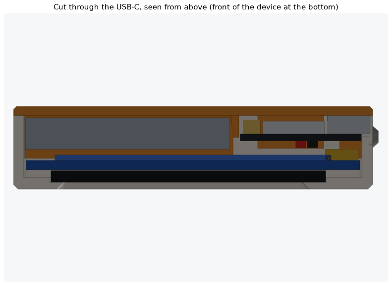

Looking at the screen:
- **Right end:** USB-C, plus 2 screws (top and bottom corners).
- **Left end:** 1 screw (top corner).
- **Top edge:** buttons A (left) and B (right), the switch stems through round holes.
- **Bottom edge:** the magnetic connector, right of center.
- **Back:** pinholes for the XIAO's R (reset) and B (boot) buttons, and 2 small light
  windows. The red charging light shows through the one next to R.

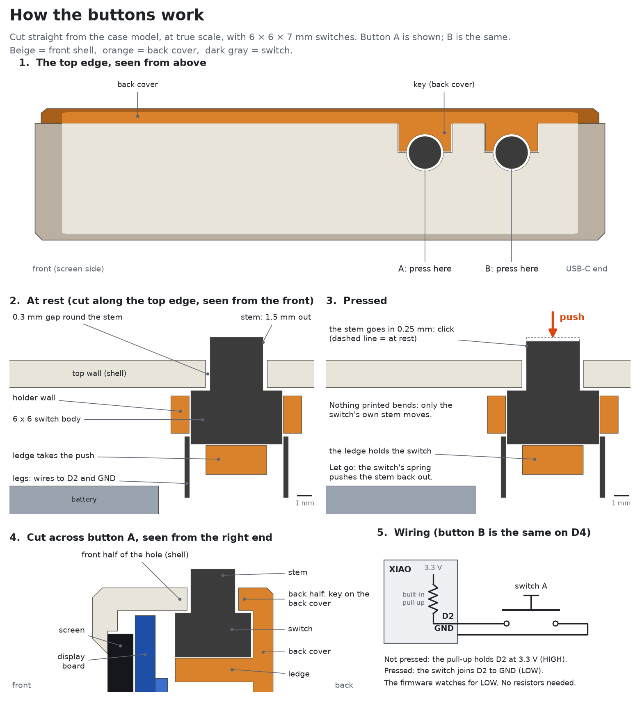

## 1. Measure first (5 minutes)

Most numbers come from the seller's manual or your photo, not from your actual parts.
Measure these with calipers. If any differ, change the setting at the top of
`build_case.py` and rebuild (see the last section).

| Part | Measure | Setting | Used now |
|---|---|---|---|
| Display | **which end the 7-pin header is on**, with the picture upright | (tell me if it's the left) | right end (the end with the wider border) |
| Display board | length × height × thickness | `PCB_L`, `PCB_H`, `PCB_T` | 58.04 × 37.5 × 1.6 (manual) |
| Display glass | length × height × thickness | `GLASS_L`, `GLASS_H`, `GLASS_T` | 47.8 × 34.6 × 2.03 (manual) |
| Display | board's left edge → lit area's left edge (the pin header end on the right) | `PCB_TO_ACTIVE` | 6.8 (photo) |
| Display | glass left edge → lit area left edge | `GLASS_TO_ACTIVE` | 2.5 (photo) |
| Battery | length × width × thickness | `BATTERY` (room allowed) | 35.5 × 30.5 × 5.5 |
| XIAO | how far the USB-C sticks out past the board | `USB_OVERHANG` | 1.6 |
| Switches | total height including the stem, and the stem's diameter | `SWITCH_H`, `STEM_D` | 7.0 total (a 6 × 6 × 7), 3.5 stem |
| Magnetic connector (device half) | face width × face thickness × depth behind the face | `MAG_W`, `MAG_T`, `MAG_D` | 9 × 4 × 6 (**guess**) |

**The magnetic connector is the biggest unknown.** If yours has mounting ears, snip
them off or send me its size.

## 2. Shopping list

| Item | Notes |
|---|---|
| 2 × 6 × 6 × 7 mm tactile switches with 2 legs | Taller ones up to 10 mm also fit (set `SWITCH_H`). The 6 × 6 × 4.5 ones are too short to reach through the wall |
| 3 × M2 × 5 flat-head (countersunk) self-tapping screws | "M2x5 countersunk tapping screw"; M2 × 6 also works |
| 1 × Schottky diode: SS14 (small, surface-mount) or 1N5817 / 1N5819 | Protects against plugging in the connector backwards (see Wiring) |
| 30 AWG silicone wire, a few colors | Soft and thin. About 6 cm per display wire |
| Heat-shrink, 1.5 mm | For the diode and joints |
| Double-sided foam tape, about 1 mm | Holds the XIAO and the battery to the back cover |
| Thin foam, about 0.5 mm (or 2 layers of foam tape) | 3 small pads where the cover's tabs press the display |
| Kapton tape | Over the solder joints on the back of the display board |
| CA glue or 5-minute epoxy | For the magnetic connector halves |
| Dock only: 4 stick-on rubber feet (8 mm) and up to 3 US quarters | The quarters add weight so the dock stays put |
| Optional: a small 2.4 GHz FPC antenna (U.FL / IPEX1, under 30 × 6 mm) | See "Wi-Fi antenna" below |

## 3. Print

All files in `stl/` already sit the right way up. **None need supports.**

| File | Orientation | Notes |
|---|---|---|
| `case_shell.stl` | front face down | PLA or PETG |
| `case_back_cover.stl` | outside face down | the letters are debossed into the bed side |
| `dock.stl` | base down | optional |
| `fit_test_front.stl`, `fit_test_button_wall.stl`, `fit_test_button_holder.stl` | as they are | print these first |

Settings: 0.2 mm layers, 0.4 mm nozzle, 3 walls, 20 % infill. The shell and the back
cover are about 7 g each, and the dock about 31 g at full density (less with infill).

## 4. Fit tests (about 15 minutes of printing)

1. **`fit_test_front.stl`:** lay the display in face-down.
   - The glass should sit flat in its pocket.
   - The black border should look even all around the window.
   - The board must not jam against the walls.

   If the window is off, change `PCB_TO_ACTIVE` / `GLASS_TO_ACTIVE`. If it doesn't fit,
   change the board or glass sizes.
2. **Button test:** slide a switch into `fit_test_button_holder`: stem toward the top
   edge, pushed toward the cover until the stem sits in the key's half-hole, legs under
   the side walls. It should be a snug push fit. Slide `fit_test_button_wall` on so the
   key fits its slot, and line up the outside edges. Press the stem: it should click
   and spring back without rubbing.
   - Stem rubs in its hole: raise `STEM_HOLE` by 0.2.
   - Switch loose in its holder: a drop of glue on the ledge.
   - Stem sticks out too far or not enough: measure the switch's full height and set
     `SWITCH_H`.

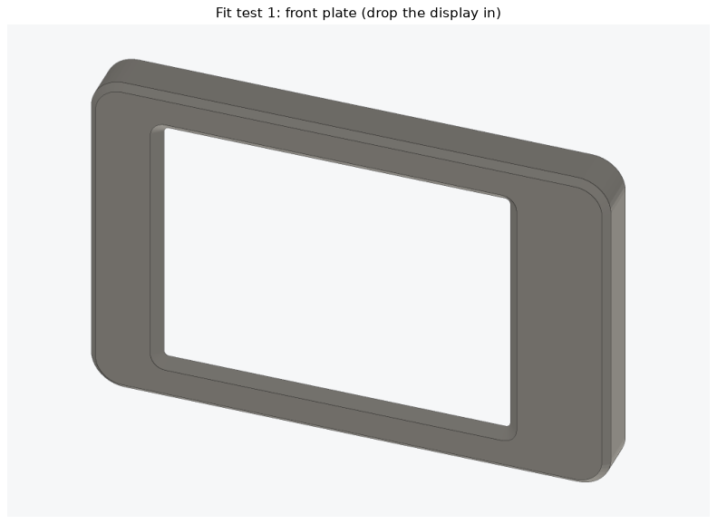
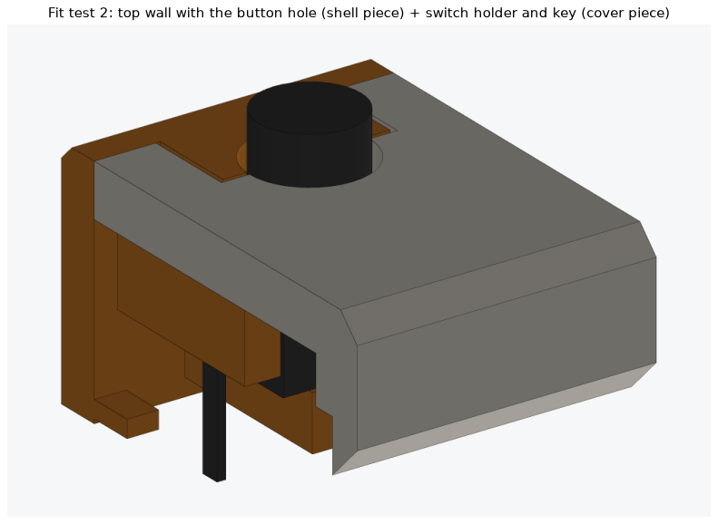

## 5. Wiring

Use the XIAO **without** pin headers (the headers add about 8 mm). The display is
wired as it is now:

| From | To the XIAO | Notes |
|---|---|---|
| Display VCC | 3V3 | |
| Display GND | GND | twist all GND wires together into the one GND pad |
| Display SCL | D8 | |
| Display SDA | D10 | |
| Display RES | D3 | |
| Display DC | D1 | |
| Display CS | D0 | |
| Button A (left) | D2 and GND | either leg to either |
| Button B (right) | D4 and GND | |
| Magnetic connector + | through the diode to the **5V** pad | diode's stripe (cathode) toward the 5V pad |
| Magnetic connector − | GND | |
| Battery red | **BAT+** (underside pad, farther from the USB-C) | check polarity twice |
| Battery black | **BAT−** (underside pad, nearer the USB-C) | |
| Antenna | the U.FL socket | press straight down until it clicks |

```
 Magnet +  ──►|── 5V        (SS14 / 1N5817: the stripe faces the 5V pad)
 Magnet −  ────── GND
```

- **Why the diode:** Seeed says to use one when feeding the 5V pin. It also stops a
  backwards connector from doing damage. And it keeps the USB-C's 5 V off the magnetic
  contacts when you program the board on USB.
- **Wire length:** leave the display wires about 6 cm long, so the back cover can
  open like a book while you work.
- **Charging:** the XIAO charges the battery at about 100 mA from either the USB-C or
  the magnetic connector. A 500 mAh battery fills in roughly 5–6 hours.

## 6. Assembly

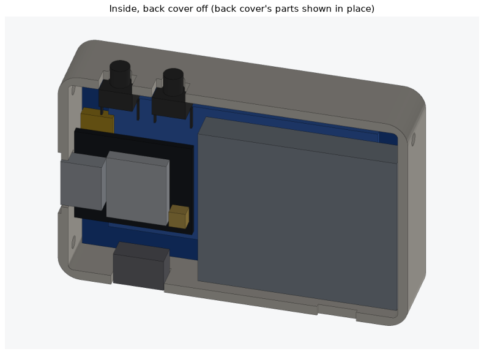

1. **Display:**
   - Cut the header pins to about 1.5 mm, or desolder the header, then solder 7 wires
     (6 cm each).
   - Put Kapton tape over the joints.
   - The back of the display has only about 2 mm of room under the XIAO.
2. **XIAO:**
   - Solder its wires: display, buttons, GND, 5V (from the diode), and the battery
     wires on the underside pads.
   - Plug in the antenna.
3. **Switches:** solder 2 wires to each switch's legs. Push each one into its holder on
   the back cover: stem toward the top edge, slid toward the cover until the stem sits
   in the key's half-hole, legs under the side walls. A small drop of glue on the ledge
   stops it from falling out while you close the case.
4. **Magnetic connector (device half):** solder its wires (the + wire through the
   diode), then glue it into its holder. Its face should end flush with the case's
   bottom.
5. **XIAO onto the cover:**
   - Put 1 mm foam tape on the XIAO's metal can.
   - Set the USB-C between the two little ridges at the cover's right edge. The two
     corner posts locate the far end.
   - Press it down.
6. **Battery:** foam tape, into the left part of the cover, wires toward the XIAO.
7. **Antenna:** stick it on the strip along the top edge above the battery (see
   below). Route the cable past the battery's right end.
8. **Test before closing:**
   - Plug in USB-C. The screen should show the weather (with the bot running).
   - Press each button. The status screen shows the Wi-Fi signal.
9. **Display into the shell:** drop it face-down into the glass pocket. Stick the
   3 thin foam pads on the cover's tabs: top-left, top-right and bottom-right corners.
10. **Close:**
    - Fold the cover onto the shell with the wires tucked in. The USB-C, the connector
      and the two button keys slide into their slots, and the stems come out through
      their holes.
    - Press it home and drive in the 3 screws. Stop as soon as they're snug, since
      they cut their own thread.
11. **Dock (optional):**
    - Snap the dock half of the connector onto the device's half (magnets only join one
      way). Mark the side of it that faces the screen.
    - Glue it into the dock floor, mark toward the front, with the cable down through
      the channel and out the groove underneath.
    - Glue 3 quarters into the coin pocket and stick on the 4 feet.

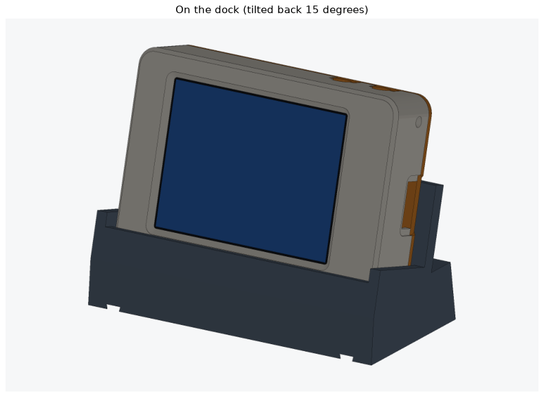

## 7. Using it

- **On the dock:** it charges. The red light shows through the back window next to R.
- **Lift it off** by tipping it forward, not straight up. That way the magnets let go
  without lifting the dock.
- **Buttons:**
  - A short press on A or B shows the status screen for 10 seconds (Wi-Fi name,
    signal, IP address, when the bot last sent the weather).
  - Holding both for 3 seconds starts Wi-Fi setup.
- **Pinholes (paperclip):**
  - **R** restarts the board.
  - **B** held for 3 seconds also starts Wi-Fi setup.
  - If an upload ever fails: hold B, tap R, release B, then upload again.
- **Off the dock** it runs about 3–4 hours (estimate). The screen's backlight can't
  be turned off on this display. When the battery runs low, its protection circuit
  switches everything off, and it charges again on the dock.

## Things to know

- **Wi-Fi antenna:**
  - The XIAO's own flat antenna is about 39 × 19 mm. Only a strip about 30 × 6 mm along
    the top edge is free of the battery and metal, so it doesn't fit cleanly.
  - Your signal is already −73 dBm ("weak") with the board in the open.
  - Options, best first:
    - a small FPC antenna in the top strip;
    - the stock antenna bent into the strip and onto the inside of the top wall;
    - the stock antenna stuck on the cover over the battery. This is the worst for
      signal, because the battery's metal foil sits right behind it.
  - Check the signal on the status screen before you close the case. "Weak" works;
    "poor" (below −80) will drop out.
- **Buttons:** with 6 × 6 × 7 switches the stems stand 1.5 mm out of the top edge.
  You press the switch itself, so a press feels exactly like the bare switch. The
  ledge under each switch takes the push, not the solder joints.
- **Heat:** the XIAO uses about 0.4 W with Wi-Fi on. The vents above it let warm air
  out the back. Keep the battery's 1.8 mm air gap from the XIAO, and don't pinch
  the battery anywhere.
- **Battery safety:** never charge a puffy battery. The case leaves room for normal
  swelling (0.5 mm), not for a damaged pack.
- **No power switch:** if you need one, a tiny slide switch in the battery's red wire
  fits beside the XIAO.

## Changing the design

All sizes are at the top of `build_case.py`. After a change, rebuild (one-time setup
first):

```bash
py -m venv cadenv
cadenv\Scripts\pip install manifold3d numpy matplotlib
cadenv\Scripts\python build_case.py
cadenv\Scripts\python viewer\make_viewer.py
```

The last line refreshes the 3D viewer page. Every run of `build_case.py` makes the STL
files and pictures again and repeats the fit checks:
- **Collisions:** nothing collides, in the closed case or in the dock.
- **Insertion paths:** the display slides into the empty shell. Each switch slides into
  its holder. The loaded back cover closes straight in without hitting anything.
- **Clearances:** how far the button stems stand out and their room in the holes, the
  gaps between parts, and the connector faces meeting.
- **Printability:** how much surface faces down in each part's print orientation.

Lines starting with `!!` mean something collides or won't assemble.

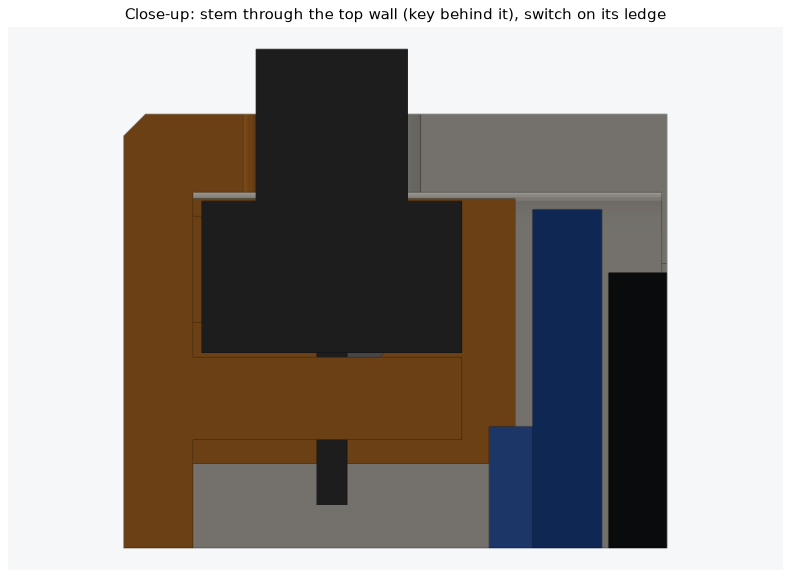
